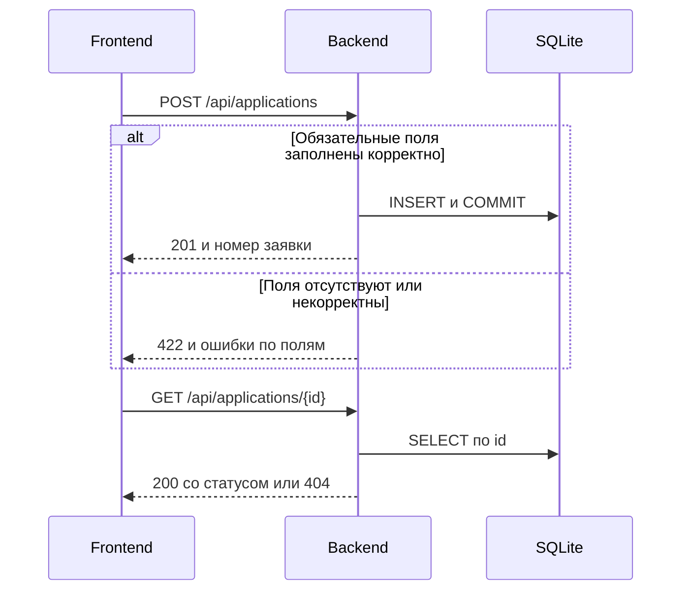

# Портфолио системного аналитика

Два командных проекта и учебное демо для собеседования на стажировку системного аналитика.

| Проект | Что разбираю |
| --- | --- |
| [IC Line](docs/CASES.md#ic-line) · хакатон, основной кейс | Как дата начала действия условия влияет на пересчёт, что возвращает API и как проверить конфликт версий. |
| [Library Management System](docs/CASES.md#library-management-system) · университетский проект | Как запрос к каталогу проходит через контроллер, сервис и репозиторий. Чем отличаются постраничная выдача, поиск и фильтр. |

## Учебное демо «Заявка на подключение услуги»

Дополнение к двум кейсам на вымышленных данных. Показывает, как требования превращаются в форму, контракт REST API, запись в базе и критерии приёмки. [Короткое ТЗ и задачи для frontend и backend](docs/SPEC.md)

## Запуск

Понадобится Python 3.11 или новее. Выполните команду из корня репозитория.

```powershell
python demo/server.py
```

Откройте [демо на 127.0.0.1:8765](http://127.0.0.1:8765). SQLite создаёт файл `demo/applications.sqlite3` при первом запуске и сохраняет заявки между запусками. Для остановки нажмите Ctrl+C. Если порт занят, добавьте `--port 8766` и откройте новый адрес.

## Что показать

| Действие | Результат |
| --- | --- |
| Отправить пустую форму | Ошибки под двумя полями, API отвечает `422`, количество заявок в базе прежнее. |
| Ввести вымышленный псевдоним «Демо-клиент», выбрать eSIM и отправить | API отвечает `201`, на экране номер и статус «Принята». Номер подставляется в форму проверки. |
| Нажать «Проверить статус» | Отдельный запрос получает ту же заявку из базы. |
| Нажать «Подставить пример», затем «Проверить статус» | Появляется «На рассмотрении» для заявки, добавленной при запуске. |

## Взаимодействие frontend и backend



## Пример API

```http
POST /api/applications HTTP/1.1
Host: 127.0.0.1:8765
Content-Type: application/json

{"applicant_alias":"Демо-клиент","service_type":"esim"}
```

```http
HTTP/1.0 201 Created
Content-Type: application/json; charset=utf-8
Location: /api/applications/672b4a42-725c-4566-a129-f128a29dbed0

{
  "id": "672b4a42-725c-4566-a129-f128a29dbed0",
  "service_type": "esim",
  "status": "RECEIVED",
  "created_at": "2026-01-01T09:30:00Z"
}
```

При создании сервер подставляет свой UUID и время. `GET` по фактическому адресу из `Location` возвращает ту же структуру с кодом `200`. Если отправить только `{"service_type":"esim"}`, сервер ответит `422`.

```json
{
  "error": {
    "code": "VALIDATION_ERROR",
    "message": "Проверьте поля заявки.",
    "fields": {
      "applicant_alias": "Укажите псевдоним длиной от 1 до 60 символов."
    }
  }
}
```

## SQL и проверки

[SQL-запрос](demo/status_counts.sql) группирует сохранённые заявки по текущему статусу. В результате есть по строке на каждый статус, встречающийся в таблице.

```sql
SELECT status, COUNT(*) AS applications_count
FROM applications
GROUP BY status
ORDER BY status;
```

Автоматические проверки API и SQL запускаются на временной базе.

```powershell
python -m unittest discover -s tests -v
```
